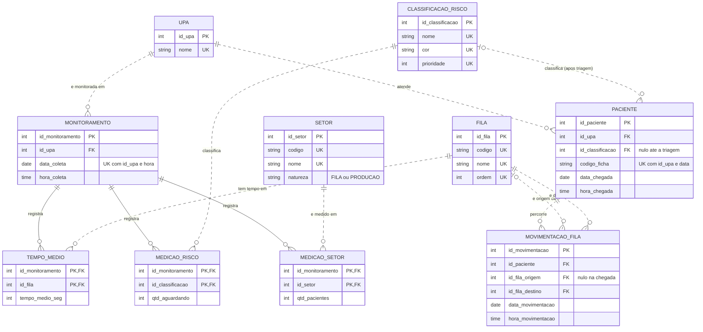

# Atividade – Sistema UPA Monitor de Porto Velho (versão com base nos prints do sistema)

## 0. Análise do sistema oficial (base das duas questões)

Fonte: 3 prints do UPA Monitor (a data/hora da captura **não aparece** nos prints; informe a sua).

| O que o sistema mostra | Observado nos prints |
|---|---|
| Resumo geral | Total Aguardando = **49**, Casos Críticos = **0**, UPAs Online = **6**, Total Atendimentos = **1052** |
| UPAs (6) | UPA Leste, UPA Leste Extensão – Odontologia, UPA Sul, Ana Adelaide, UPA José Adelino da Silva, Jaci Paraná |
| Por UPA | "Aguardando Atendimento" (total), **dois** tempos médios de espera (**Classificação** e **Consultório**, em h/min/s) |
| Classificação de risco (aguardando) | 5 níveis: Emergência, Muito Urgente, Urgente, Pouco Urgente, Não Urgente |
| Pacientes por setor | 15 indicadores: Aguardando Triagem, Pacientes Triados, Atendidos Consultório, Sutura, Sala Vermelha, Observação Masculina/Feminina/Infantil, Medicação Administrada, Exames Laboratório, Exames Radiologia, Odontologia, Atendimento Pediátrico, Assistência Social, Transferências |

**Conferências que fiz com os números dos prints**
- Soma dos totais por UPA: 7 + 0 + 25 + 13 + 4 + 0 = **49** ✔ (bate com o Resumo geral). Em cada UPA, o total = soma das 5 classificações (ex.: Sul 3 + 22 = 25).
- **"Aguardando Triagem" não entra no total aguardando** (ex.: Ana Adelaide tem 6 aguardando triagem e total 13 só das classificações): é uma fila anterior, de outra natureza.
- Os tempos médios são **por UPA, não por cor nem por setor**: não existe tempo de espera por classificação de risco no sistema.
- "Pacientes por setor" mistura **estoque** (Aguardando Triagem) com **contadores** do período (Triados, Atendidos, Medicação…). Esses contadores se sobrepõem (o mesmo paciente é triado, atendido e medicado), então **não podem ser somados entre si**.
- Total Atendimentos = 1052 **não** bate com a soma de Atendidos Consultório (855). Atendidos Consultório + Atendimento Pediátrico = 1048 (diferença de 4, possivelmente por prints tirados em momentos diferentes). **Definição a confirmar.**
- UPA Leste Extensão não exibe tempos médios; no print da UPA Leste a linha *Transferências* está cortada (não capturada).

---

## QUESTÃO 1 – Diagrama ER (MERMAID)

### Justificativas técnicas
- **Novas tabelas pedidas:** `FILA` (etapas do fluxo), `TEMPO_MEDIO` (tempo médio por fila e coleta), `PACIENTE` (passagem pseudonimizada) e `MOVIMENTACAO_FILA` (cada mudança de fila).
- **Atenção:** o UPA Monitor **não exibe pacientes nem movimentações**; `PACIENTE` e `MOVIMENTACAO_FILA` são a estrutura necessária para medir o tempo de mudança entre filas e só podem ser alimentadas pelo sistema de origem (ou por dados fictícios de teste).
- **1FN:** atributos atômicos (tempos em segundos). **2FN:** nas tabelas com PK composta, os atributos dependem da chave inteira. **3FN:** o tempo de mudança entre filas não é gravado (derivado de duas movimentações); o total aguardando também é calculado; nomes e cores ficam nas tabelas de domínio.
- **Duas FKs para FILA** em `MOVIMENTACAO_FILA` (origem e destino); a origem é opcional (`|o`) porque a chegada não vem de nenhuma fila.
- **Cardinalidades:** `||..o{` = cada monitoramento pertence a exatamente uma UPA; uma UPA pode ter zero ou muitos monitoramentos (nova UPA ainda sem coleta). Idem para as tabelas de domínio.
- **Limitação:** se o sistema ou o banco tiver campos não visíveis nos prints (ex.: tempo por paciente), o modelo deve ser estendido.

### Autoavaliação (0,50)
| Critério | Pontos | Evidência |
|---|---|---|
| Análise do sistema | 0,10 | Seção 0, com conferências numéricas |
| Sintaxe MERMAID | 0,10 | Teste no mermaid.live antes de entregar (print do render) |
| Cardinalidades | 0,20 | `--` / `..` e `\|\|`/`o{` justificados |
| Atributos | 0,05 | Tipos + PK/FK/UK |
| Documentação | 0,05 | Comentários `%%` |

---

## QUESTÃO 2 – Prompt Inverso

### 2.1 Log da conversa com a IA (real, desta conversa)

**Prompt 1 (aluno):** colou o enunciado completo e pediu *"faça essa atividade atendendo os critérios… e fazendo as atividades pedidas"*.

**Resposta 1 (IA):** disse que o site bloqueou acesso automatizado e montou modelo "por inferência": 2 UPAs fictícias, setores *Clínica Médica Adulto* e *Pediatria*, tempo médio e máximo **por cor de risco**, metas de 0/10/60/120/240 min e `sp_*` baseadas nisso.

**Prompt 2 (aluno):** enviou 3 prints do sistema e pediu para refazer usando o site como base.

**Comentários do aluno sobre os erros da IA (conferidos contra os prints):**
| # | Erro da Resposta 1 | O que o sistema mostra | Correção |
|---|---|---|---|
| 1 | **Setores inventados** (Clínica Médica Adulto, Pediatria) | 15 indicadores (Triagem, Sutura, Sala Vermelha…) | Tabela SETOR com os 15 |
| 2 | **Tempo de espera por cor de risco** | Só 2 tempos médios **por UPA** (classificação e consultório) | Tempos em MONITORAMENTO |
| 3 | **Metas de espera por cor** aplicadas como indicador do sistema | O sistema não exibe metas | Removidas; nenhum indicador inventado |
| 4 | Tratou *setor* como lugar onde o paciente espera | Setor = contador de etapas/procedimentos | `natureza` FILA vs PRODUCAO |
| 5 | **Contagem de pacientes**: somar linhas de vários indicadores como "pacientes" | Triados, atendidos e medicados se sobrepõem | Sem total "todos os setores" |
| 6 | **Média de médias** para o tempo geral | O correto é ponderar | Ponderação por triados / atendidos |
| 7 | Ignorou **Aguardando Triagem** (fora do total de 49) | Fila separada | Coluna própria |
| 8 | Dados de teste de 2 UPAs fictícias | 6 UPAs reais | Carga com os valores dos prints |
| 9 | (Pedido 3) Guardar o tempo de mudança de fila como coluna | Seria dado derivado e poderia ficar inconsistente com as datas | Calculado com `LAG()` entre movimentações |

**Prompt 3 (aluno):** *"Adicione: tabela de tempo médio, tabela de pacientes, tabela de fila e tempo de mudança de uma fila pra outra."* **Resposta 3 (IA):** criou `TEMPO_MEDIO`, `PACIENTE`, `FILA`, `MOVIMENTACAO_FILA` e `sp_tempo_transicao_filas`. **Comentários do aluno:** (a) o site não tem dados de pacientes, então os dados dessas tabelas são fictícios e identificados como `TESTE-nnn`; (b) paciente sem nome/CPF por LGPD; (c) pacientes ainda na fila não entram na média da transição (não têm a movimentação seguinte).

**Validação do aluno:** reproduzi o total 49 e as somas por UPA (seção 0). Em outro ponto, a média simples dos tempos de consultório (00:35:18) difere da ponderada (**00:40:52**): a ingênua subestima o tempo porque dá o mesmo peso à Jaci Paraná (41 atendidos) e à UPA Leste (224).

### 2.2 Código final
Arquivo completo e comentado: **`upa_monitor.sql`** (DDL, carga real dos prints, `sp_quadro_de_filas`, `sp_atlas_e_cubos`, `EXEC`). Resumo:
- **`sp_quadro_de_filas(@id_upa)`:** `ROW_NUMBER()` pega a última coleta de cada UPA; mostra aguardando triagem, 5 classificações, total, casos críticos, % urgente ou mais e os dois tempos médios; `ROLLUP` cria o TOTAL GERAL com tempo **ponderado**.
- **`sp_atlas_e_cubos(@data_inicio,@data_fim,@id_upa)`:** cubo UPA × setor com `GROUPING SETS` (total por UPA/setor e total do setor em todas as UPAs); depois desempenho por UPA: triados, atendidos, % atendidos/triados e tempos ponderados. Contadores acumulados no dia: usa MAX por dia antes de somar entre dias (hipótese a confirmar).
- **`sp_tempo_transicao_filas(@data_inicio,@data_fim,@id_upa)` (nova):** `LAG()` por paciente calcula o tempo na fila de origem entre movimentações consecutivas; devolve, por UPA e total, a quantidade, o tempo médio, mínimo e máximo de cada transição, e depois o tempo médio por classificação de risco.
- Hipóteses sinalizadas no código: "casos críticos" = Emergência + Muito Urgente; contadores acumulados no dia.

### 2.3 Resultados (dados reais dos prints; calculados por script)
> Os valores abaixo vêm dos prints e foram calculados com a mesma lógica das procedures. **Não foram executados em SQL Server por mim**: rode o `.sql` e substitua/acompanhe com seus prints do SSMS. Informe a data/hora da captura (variáveis `@data`/`@hora`).

**`EXEC sp_quadro_de_filas`**

| UPA | Aguard. triagem | Emerg. | Muito urg. | Urgente | Pouco urg. | Não urg. | Total aguard. | % urgente+ | Tempo classif. | Tempo consultório |
|---|---|---|---|---|---|---|---|---|---|---|
| ANA ADELAIDE | 6 | 0 | 0 | 3 | 8 | 2 | 13 | 23,1 | 00:20:09 | 00:50:33 |
| JACI PARANÁ | 0 | 0 | 0 | 0 | 0 | 0 | 0 | – | 00:09:35 | 00:08:49 |
| UPA JOSÉ ADELINO DA SILVA | 0 | 0 | 0 | 0 | 4 | 0 | 4 | 0,0 | 00:07:01 | 00:18:53 |
| UPA LESTE | 1 | 0 | 0 | 1 | 6 | 0 | 7 | 14,3 | 00:08:39 | 00:28:33 |
| UPA LESTE EXTENSÃO - ODONTOLOGIA | 0 | 0 | 0 | 0 | 0 | 0 | 0 | – | NULL | NULL |
| UPA SUL | 1 | 0 | 0 | 3 | 22 | 0 | 25 | 12,0 | 00:07:02 | 01:09:44 |
| **TOTAL GERAL** | 8 | 0 | 0 | 7 | 40 | 2 | **49** | 14,3 | 00:10:26 | 00:40:52 |

Casos críticos = 0 em todas (coincide com o Resumo geral do site). Total aguardando = 49 ✔.

**`EXEC sp_atlas_e_cubos` – resultado 1** (linhas "TODAS AS UPAs" = total do setor; a procedure também devolve uma linha por UPA × setor, com os valores da matriz abaixo)

| Setor | Leste | Leste Ext. | Sul | Ana Adelaide | José Adelino | Jaci Paraná | **TODAS AS UPAs** |
|---|---|---|---|---|---|---|---|
| PACIENTES TRIADOS | 266 | 0 | 285 | 222 | 196 | 47 | **1016** |
| ATENDIDOS CONSULTÓRIO | 224 | 0 | 213 | 196 | 181 | 41 | **855** |
| SUTURA | 33 | 0 | 38 | 15 | 1 | 1 | **88** |
| SALA VERMELHA | 4 | 0 | 4 | 2 | 7 | 0 | **17** |
| OBSERVAÇÃO MASCULINA | 8 | 0 | 14 | 34 | 0 | 4 | **60** |
| OBSERVAÇÃO FEMININA | 2 | 0 | 17 | 31 | 0 | 7 | **57** |
| OBSERVAÇÃO INFANTIL | 0 | 0 | 5 | 5 | 0 | 1 | **11** |
| MEDICAÇÃO ADMINISTRADA | 403 | 0 | 332 | 371 | 314 | 65 | **1485** |
| EXAMES LABORATÓRIO | 137 | 0 | 303 | 209 | 92 | 21 | **762** |
| EXAMES RADIOLOGIA | 76 | 0 | 98 | 66 | 44 | 11 | **295** |
| ODONTOLOGIA | 1 | 8 | 15 | 0 | 0 | 0 | **24** |
| ATENDIMENTO PEDIÁTRICO | 49 | 0 | 43 | 50 | 40 | 11 | **193** |
| ASSISTÊNCIA SOCIAL | 5 | 0 | 0 | 0 | 0 | 0 | **5** |
| TRANSFERÊNCIAS | *(não capturado)* | 0 | 20 | 1 | 1 | 1 | **23*** |

\* Exclui a UPA Leste (linha cortada no print).

**Resultado 2 – desempenho por UPA**

| UPA | Triados | Atendidos consultório | % atendidos/triados | Tempo classif. | Tempo consultório |
|---|---|---|---|---|---|
| ANA ADELAIDE | 222 | 196 | 88,3 | 00:20:09 | 00:50:33 |
| JACI PARANÁ | 47 | 41 | 87,2 | 00:09:35 | 00:08:49 |
| UPA JOSÉ ADELINO DA SILVA | 196 | 181 | 92,3 | 00:07:01 | 00:18:53 |
| UPA LESTE | 266 | 224 | 84,2 | 00:08:39 | 00:28:33 |
| UPA LESTE EXTENSÃO - ODONTOLOGIA | 0 | 0 | – | NULL | NULL |
| UPA SUL | 285 | 213 | 74,7 | 00:07:02 | 01:09:44 |
| **TOTAL GERAL** | 1016 | 855 | 84,2 | 00:10:26 | 00:40:52 |

**Leitura gerencial:** a UPA Sul tem a maior fila (25, 22 pouco urgentes), o maior tempo de consultório (1h09) e a menor taxa de atendimento sobre triados (74,7%); Ana Adelaide tem o maior tempo de classificação (20 min).

**`EXEC sp_tempo_transicao_filas` – DADOS FICTÍCIOS (pacientes TESTE-001 a TESTE-007)**

Resultado 1

| UPA | Transição | Pacientes | Tempo médio | Mínimo | Máximo |
|---|---|---|---|---|---|
| UPA LESTE | AGUARDANDO TRIAGEM -> AGUARDANDO CONSULTÓRIO | 2 | 00:07:00 | 00:05:00 | 00:09:00 |
| UPA SUL | AGUARDANDO TRIAGEM -> AGUARDANDO CONSULTÓRIO | 4 | 00:06:30 | 00:05:00 | 00:08:00 |
| TODAS AS UPAs | AGUARDANDO TRIAGEM -> AGUARDANDO CONSULTÓRIO | 6 | 00:06:40 | 00:05:00 | 00:09:00 |
| UPA LESTE | AGUARDANDO CONSULTÓRIO -> EM CONSULTÓRIO | 2 | 00:40:00 | 00:15:00 | 01:05:00 |
| UPA SUL | AGUARDANDO CONSULTÓRIO -> EM CONSULTÓRIO | 3 | 00:48:20 | 00:20:00 | 01:15:00 |
| TODAS AS UPAs | AGUARDANDO CONSULTÓRIO -> EM CONSULTÓRIO | 5 | 00:45:00 | 00:15:00 | 01:15:00 |

Resultado 2 (por classificação)

| Transição | Classificação | Pacientes | Tempo médio |
|---|---|---|---|
| AGUARDANDO TRIAGEM -> AGUARDANDO CONSULTÓRIO | URGENTE | 2 | 00:06:00 |
| AGUARDANDO TRIAGEM -> AGUARDANDO CONSULTÓRIO | POUCO URGENTE | 3 | 00:06:40 |
| AGUARDANDO TRIAGEM -> AGUARDANDO CONSULTÓRIO | NÃO URGENTE | 1 | 00:08:00 |
| AGUARDANDO CONSULTÓRIO -> EM CONSULTÓRIO | URGENTE | 2 | 00:17:30 |
| AGUARDANDO CONSULTÓRIO -> EM CONSULTÓRIO | POUCO URGENTE | 3 | 01:03:20 |

Os pacientes TESTE-004 (ainda aguardando consultório) e TESTE-007 (ainda aguardando triagem) não entram na média da etapa que não concluíram. Estes valores são de teste e **não** representam o desempenho real das UPAs.

### Limitações declaradas
1. Os prints mostram um único instante: não há histórico, então a lógica de várias coletas (`ROW_NUMBER`, MAX por dia) está implementada mas não foi exercitada com dados reais.
2. Não tenho acesso ao banco do sistema: o modelo é inferido da interface (atributos não visíveis ficam de fora).
3. Definições a confirmar: período dos contadores por setor, "Casos Críticos" e "Total Atendimentos" (1052).
4. Sem acesso aos dados de pacientes/movimentações do sistema oficial: `PACIENTE` e `MOVIMENTACAO_FILA` têm apenas dados fictícios de teste.
5. As procedures não foram executadas em SQL Server por mim; os resultados acima foram calculados por script.
